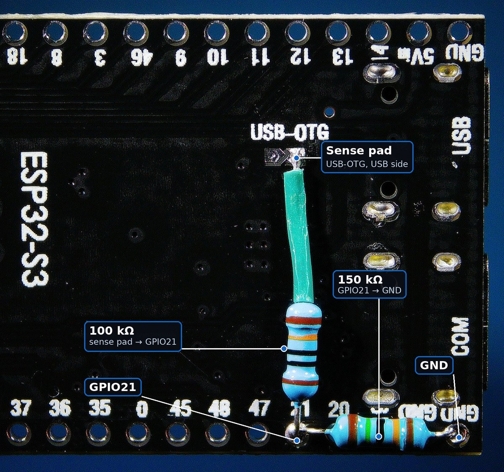

# VBUS sense modification (optional)

Two resistors let the board sense the target's USB power, so the viewer can
tell a sleeping target ("asleep; a keypress may wake it") from an unplugged
or powered-off one ("unplugged or powered off"). Without it, both look the
same over USB, and the viewer says "asleep or disconnected". See "Asleep or
unplugged" in [the protocol spec](../development/protocol.md) for why.

Even with the mod, "no USB power" isn't conclusive: some computers cut USB
power when fully off or hibernating, and some keep it on.

## What you need

- **Two resistors** in a 2:3 ratio (through-hole, 1/8 or 1/4 W; 5% is fine).
  Only the ratio sets the voltage, so any of these pairs works:

  | Pair | Strengths | Trade-offs |
  |------|-----------|------------|
  | **10 kΩ / 15 kΩ** | Stiffest signal: swamps leakage on the sense pad and ignores noise | About 0.6 mA through the pin's protection in a plug-in spike; up to about 0.4 mA can back-feed an unpowered board; draws 0.2 mA from the target |
  | **47 kΩ / 68 kΩ** | A good middle: about 3.03 V at the pin, both currents roughly halved | None worth worrying about |
  | **100 kΩ / 150 kΩ** | Gentlest on the pin and on an unpowered board (about a tenth of the 10k currents) | Leakage on the sense pad shows up at the pin: 26 mV on the tested clone, far below the 0.8 V where it would read high, but less margin on a leakier board or a hot day; more prone to picking up noise |

  For belt and braces, use **100 kΩ / 150 kΩ plus the optional 100 nF
  capacitor** (see below): the capacitor takes care of noise and spikes.
  Whichever you choose, the check at the end of "Wiring" confirms it on your board.
  The wiring below says 10 kΩ and 15 kΩ; substitute your pair.
- Optionally, a **100 nF** ceramic capacitor.
- A soldering iron and a multimeter.

## Where it goes

These notes are for the ESP32-S3-DevKitC-1 clones in [What to buy](bom.md)
(AITRIP and DORHEA). Check your own board with a multimeter before
soldering: clones differ, and the solder pads in particular don't always
match Espressif's board.

On the underside, near the USB ports, are two pairs of solder pads:

- **IN-OUT** bypasses the diode on the **5V header pin**, so that pin can
  supply power out. Not the one we want.
- **USB-OTG** bypasses the diode on the **native USB port** (the one that
  goes to the target). One of its pads carries the target's 5 V: that's the
  sense point.

To find the right pad, plug both ports in (your computer to UART, the target
to USB, target on) and measure each USB-OTG pad to GND:

| | Target plugged in | Target unplugged |
|---|---|---|
| Target-side pad (the sense point) | about 5 V | floating (a meter may show 1 to 2 V) |
| Board-side pad | about 4.6 to 4.8 V | about 4.6 V (fed from the UART port) |

On the tested clones (an N8R2 and an N16R8), the sense point is the USB-OTG
pad nearer the USB ports.

**Leave the USB-OTG pads unbridged.** Bridging them connects the target's
5 V straight to your computer's.

## Wiring

```
sense pad ──[10 kΩ]──┬── GPIO21
                     │
                  [15 kΩ]
                     │
                    GND
```

- **GPIO21** is the closest usable pin to the USB end, on the header row
  beside the two GND holes (GPIO19 and 20 next to it are the USB data lines:
  don't use those).
- The 10 kΩ runs from the sense pad to the GPIO21 hole; the 15 kΩ from the
  GPIO21 hole to a neighbouring GND hole. Everything stays on the underside.



*The finished mod on a DORHEA N16R8, underside up, USB ports to the right,
with 100k/150k. The 100 kΩ (in green sleeving) runs from the sense pad down
to the GPIO21 hole. The 150 kΩ lies flat from GPIO21 to the GND hole three
holes along; its body crosses the GPIO20 and GPIO19 holes, but only its leads
touch anything. Both leads share the GPIO21 hole, soldered from the
underside.*

The divider turns 5.12 V into 3.07 V at the pin (3.15 V at USB's maximum
5.25 V), safely under the chip's 3.3 V, and well above the 2.5 V it needs to
read a high. With nothing plugged into the target port, the 15 kΩ holds the
pin at 0 V.

**Check it before turning it on in the viewer.** With your computer on the UART
port, measure GPIO21 to GND: it should read well under 0.1 V with the target
unplugged (about 20 mV on both tested boards with 100k/150k), and about 3 V
with the target plugged in and on (3.05 V on both).

### What about plug-in spikes?

Plugging in a USB cable can make VBUS ring briefly above 5 V (the cable's
inductance against the board's capacitors), for microseconds. Even a
pessimistic 10 V spike can't hurt the pin: the GPIO's protection structures
clamp it just above the chip's supply, and the top resistor limits the
current through them to about 0.6 mA with 10 kΩ, or 60 µA with 100 kΩ.
Microcontroller datasheets typically allow a few milliamps of injected
current; Espressif doesn't publish a figure for the S3 that we know of, but
these currents are far below that. What would be dangerous is wiring VBUS to a pin
without the series resistor.

**Optional:** a 100 nF ceramic capacitor from GPIO21 to GND (alongside the
bottom resistor) turns the divider into a low-pass filter that swallows the
spikes entirely. It slows the signal by a few milliseconds at most (about
6 ms with 100k/150k), which is instant as far as the viewer is concerned.

If you use another GPIO, avoid 0, 3, 45, and 46 (boot mode); 19 and 20
(USB); 43 and 44 (the UART); 22 to 37 (flash and PSRAM); the LED pin (48 or
38); and 47 and 48 (1.8 V on some modules). The firmware refuses all of
these.

## Firmware

The firmware doesn't read the pin until it's told to, since on an
unmodified board the pin would float. With firmware 0.3.0 or later, connect
with the viewer, open **Board settings...**, set **VBUS sense mod: Present**
to **Yes**, and check the GPIO (21 for the mod above). The board keeps the
setting across firmware updates (0.4.0 and later) until it's erased.

Then check it: the status bar should say "Target: asleep" (not "asleep or
disconnected") when the target sleeps, and "unplugged or powered off" when
its cable is out. Or, without the viewer:

```sh
python tools/cb_test.py COM10 set vbus-gpio 21
python tools/cb_test.py COM10 info   # capabilities 0x001F, and vbus_present while the target is on
```

Firmware before 0.3.0 needs its own build with the pin set
(**CodeBlue → VBUS sense GPIO** in `idf.py menuconfig`; see
[Building](../development/building.md)).
